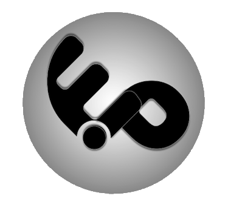

<a id="readme-top"></a>

<div align="center">
  
  <h1>EP · Brand Assets</h1>
  <p>Recursos visuais da identidade profissional de Eduardo Junior Pereira.</p>
  <p>
    <a href="https://github.com/eduardojr-pereira">GitHub</a> ·
    <a href="https://www.linkedin.com/in/eduardo-jr-pereira/">LinkedIn</a> ·
    <a href="https://eduardo-pereira.webflow.io/">Portfólio</a>
  </p>
</div>

---

## Índice

- [Visão geral](#visão-geral)
- [Recursos disponíveis](#recursos-disponíveis)
- [Estrutura de arquivos](#estrutura-de-arquivos)
- [Como utilizar](#como-utilizar)
- [Licenciamento](#licenciamento)
- [Contato](#contato)

## Visão geral

Este repositório centraliza os recursos visuais usados em READMEs, projetos e páginas do meu portfólio profissional. A organização permite reutilizar a mesma identidade em diferentes áreas técnicas.

## Recursos disponíveis

| Recurso | Prévia | Arquivo |
|---|---|---|
| Logotipo EP |  | `assets/logos/logo_initials.png` |
| GitHub |  | `assets/icons/github_icon.svg` |
| LinkedIn |  | `assets/icons/linkedin_icon.svg` |
| E-mail |  | `assets/icons/gmail_icon.svg` |
| Discord |  | `assets/icons/discord_icon.svg` |

## Estrutura de arquivos

```text
ep-brand-assets/
├── README.md
└── assets/
    ├── logos/
    │   └── logo_initials.png
    └── icons/
        ├── github_icon.svg
        ├── linkedin_icon.svg
        ├── gmail_icon.svg
        └── discord_icon.svg
```

## Como utilizar

Em outro repositório, referencie os arquivos usando o endereço público deste repositório.

**Markdown:**

```markdown

```

**HTML (controle de dimensões):**

```html

```

Se modificar nomes ou caminhos dos arquivos, atualize os endereços usados em outros repositórios.

## Licenciamento

Os recursos deste repositório fazem parte da identidade visual EP. **Não há permissão de reutilização comercial ou redistribuição implícita.** Os termos de uso podem ser definidos separadamente. Os ícones de terceiros mantêm seus próprios direitos e licenças, quando aplicáveis.

## Contato

Para entrar em contato:

<div align="center">
  <a href="mailto:eduardojr.pereira@gmail.com"></a>
  &nbsp;&nbsp;
  <a href="https://www.linkedin.com/in/eduardo-jr-pereira/"></a>
  &nbsp;&nbsp;
  <a href="https://github.com/eduardojr-pereira"></a>
  &nbsp;&nbsp;
  <a href="https://eduardo-pereira.webflow.io/"></a>
</div>

<p align="right"><a href="#readme-top">↑ VOLTAR PARA O TOPO</a></p>
