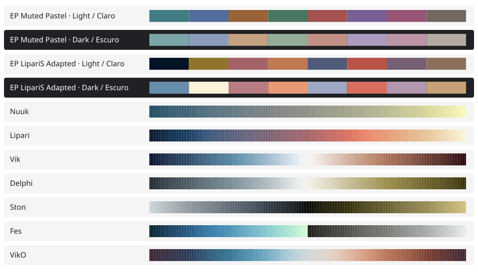
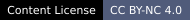

<a id="readme-top"></a>

<div align="center">

| [English](./README.md) · [Português](./README.pt-BR.md) |

# EP Brand Assets

*Visual identity, shared components and presentation infrastructure for the EP ecosystem.*

</div>

<div align="center">

[Overview](#overview) · [Visual Identity](#visual-identity) · [Shared Components](#shared-components) · [Themes and Internationalization](#themes-and-internationalization) · [EP Analytical Colour System](#ep-analytical-colour-system)<br>
[Directory Structure](#directory-structure) · [Usage and Integration](#usage-and-integration) · [Testing and Validation](#testing-and-validation) · [Related Repositories](#related-repositories) · [License](#license) · [Contact](#contact)

</div>

---

<a id="overview"></a>

## Overview

EP Brand Assets is the canonical source of visual identity and shared presentation infrastructure for the EP ecosystem. It centralizes design tokens, typography, themes, bilingual interface mechanisms, visual assets, components and renderers for the interactive portfolio, project reports and professional READMEs.

Consuming projects retain their own data, analyses and project-specific content. Shared components are maintained here rather than duplicated across repositories.

---

<a id="visual-identity"></a>

## Visual Identity

The identity uses the EP logo, institutional graphite and copper palette, shared typography, social icons and Lottie animations. The institutional palette is distinct from the analytical colour system.

| Asset | Preview | File |
|---|---|---|
| EP logo |  | [`logo_initials.png`](./assets/logos/logo_initials.png) |
| GitHub |  | [`github_icon.svg`](./assets/icons/github_icon.svg) |
| LinkedIn |  | [`linkedin_icon.svg`](./assets/icons/linkedin_icon.svg) |
| Email |  | [`gmail_icon.svg`](./assets/icons/gmail_icon.svg) |
| Discord |  | [`discord_icon.svg`](./assets/icons/discord_icon.svg) |

See [animations](./assets/animations/) and [theme tokens](./styles/theme-tokens.css).

### Badge Library

The centralized library contains 80 SVG badges: 48 technologies, 2 licenses, 6 statuses, 22 topics and 2 methods. Technologies, Licenses and Status may be used in READMEs and HTML; Topics and Methods are reserved for showcase and report HTML. See the [badge library documentation](./docs/badges.md).

> [!NOTE]
> The library has been integrated and committed locally. Integrated consumer validation and coordinated publication remain pending.

<p align="right"><sub><a href="#readme-top">↑ Back to top</a></sub></p>

---

<a id="shared-components"></a>

## Shared Components

Components are maintained in EP Brand and reused where relevant. The site builder assembles the portfolio and reports from canonical sources rather than maintaining separate implementations in each project.

| Component | Source |
|---|---|
| Institutional configuration | [`config/brand.json`](./config/brand.json) |
| Web components: Header, Footer, cards, buttons, links, navigation and controls | [`components/web/`](./components/web/) |
| Bilingual Markdown footers | [`components/markdown/`](./components/markdown/) |
| Shared scripts and interactions | [`scripts/`](./scripts/) |
| Composition, rendering and publication | [`tools/`](./tools/) |
| Regression tests | [`tests/`](./tests/) |

<p align="right"><sub><a href="#readme-top">↑ Back to top</a></sub></p>

---

<a id="themes-and-internationalization"></a>

## Themes and Internationalization

A centralized presentation layer ensures visual and linguistic consistency across the portfolio and project reports.

| Mechanism | Responsibility | Source |
|---|---|---|
| Theme tokens | Shared light and dark theme definitions | [theme-tokens.css](./styles/theme-tokens.css) |
| Typography | Consistent typographic system | [typography-v2.css](./styles/typography-v2.css) |
| Theme initialization | Initial theme configuration | [theme-init.js](./scripts/theme-init.js) |
| Theme switching | Light and dark theme transitions | [theme.js](./scripts/theme.js) |
| Internationalization | Shared bilingual interface mechanisms | [i18n.js](./scripts/i18n.js) |
| Plotly theming | Consistent analytical presentation | [plotly-theme.js](./scripts/plotly-theme.js) |
| Plotly localization | Language-specific chart presentation | [plotly-i18n.js](./scripts/plotly-i18n.js) |

> [!IMPORTANT]
> Presentation mechanisms are centralized in EP Brand, while project-specific translations remain within their respective projects. Theme and language changes affect presentation only, preserving the underlying analytical data.

<p align="right"><sub><a href="#readme-top">↑ Back to top</a></sub></p>

---

<a id="ep-analytical-colour-system"></a>

## EP Analytical Colour System

The EP Analytical Colour System separates visual encoding of data from institutional branding. Choose the class according to the data semantics, then the appropriate representation, contrast and redundant visual encoding.

| Class | Primary | Secondary | Specialized |
|---|---|---|---|
| Categorical | EP Muted Pastel | EP LipariS Adapted | — |
| Sequential | Nuuk | Lipari | — |
| Diverging | Vik | Delphi | Ston |
| Multi-sequential | Fes | — | — |
| Cyclic | VikO | — | — |



> [!WARNING]
> - **Source of Truth:** The palette preview is generated directly from [config/colormaps.json](./config/colormaps.json), the canonical colour configuration.
> - **Origin and Attribution:** Continuous scales use Scientific Colour Maps 9.0.0 by Fabio Crameri. EP LipariS Adapted is a custom adaptation, not an official scale. See the [methodology and attribution](./docs/colormaps.md) and [MIT license](./docs/LICENSE-SCIENTIFIC-COLOUR-MAPS.txt).
> - **Accessibility:** Categorical palettes require complementary visual cues, such as markers, line styles, patterns or labels. Colour contrast alone does not guarantee accessibility.
> - **Technical Integration:** The [canonical Plotly renderer](./tools/render_plotly.py) and [generated CSS](./styles/colormaps.css) use the same centralized colour configuration.

<p align="right"><sub><a href="#readme-top">↑ Back to top</a></sub></p>

---

<a id="directory-structure"></a>

## Directory Structure

<details>
<summary><strong>Repository tree</strong></summary>

```text
ep-brand-assets/
├── .github/
│   └── workflows/
├── .gitignore
├── LICENSE-BRAND.md
├── LICENSE-CODE.txt
├── LICENSE-CONTENT.md
├── README.md
├── README.pt-BR.md
├── assets/
│   ├── animations/
│   ├── badges/
│   ├── icons/
│   │   └── technologies/
│   └── logos/
├── components/
│   ├── markdown/
│   └── web/
├── config/
│   └── badges.json
├── docs/
│   └── badges.md
├── scripts/
├── styles/
├── tests/
│   └── test_badge_library.py
└── tools/
    ├── badge_html.py
    └── render_badges.py
```

</details>

- `assets/` — Visual identity resources.
- `components/` — Canonical Markdown and web components.
- `config/` — Institutional and analytical colour configuration.
- `docs/` — Technical documentation and third-party attribution.
- `scripts/` and `styles/` — Shared behaviour, themes and presentation.
- `tests/` — Automated regression tests.
- `tools/` — Rendering, composition and publication utilities.

The tree includes the badge library and reflects the local structure; coordinated publication remains pending.

<p align="right"><sub><a href="#readme-top">↑ Back to top</a></sub></p>

---

<a id="usage-and-integration"></a>

## Usage and Integration

For other repositories, use the public asset URLs.

```markdown

```

```html

```

Keep the canonical checkout of EP Brand alongside the Portfolio checkout. From EP Brand, replace the source path with your local Portfolio path; use a preview output directory outside both repositories.

```bash
python3 tools/build_site.py --source /path/to/data-science-portfolio --output /tmp/ep-portfolio-preview
```

Preview Markdown footers without writing files:

```bash
python3 tools/render_footer.py readme --kind portfolio --lang en
python3 tools/render_footer.py readme --kind knowledge-base --lang pt-BR
```

With `--file`, the renderer displays the proposed diff; only `--apply` writes changes. Review before applying. Render the web footer with embedded assets using `python3 tools/render_footer.py web --embed-assets`.

Do not rename shared assets without checking consumers. Local generation does not publish changes.

<p align="right"><sub><a href="#readme-top">↑ Back to top</a></sub></p>

---

<a id="testing-and-validation"></a>

## Testing and Validation

Run the regression suite from the repository root:

```bash
python3 -m unittest discover -s tests -v
```

Review generated previews and verify shared components, themes, language switching, navigation and analytical presentation in consuming projects before publication.

> [!NOTE]
> Final integrated validation and coordinated publication remain pending. Local generation does not publish changes.

<p align="right"><sub><a href="#readme-top">↑ Back to top</a></sub></p>

---

<a id="related-repositories"></a>

## Related Repositories

| Repository | Role |
|---|---|
| [Data Science Portfolio](https://github.com/eduardojr-pereira/data-science-portfolio) | Applied projects, interactive portfolio and project reports. |
| [Data Science Knowledge Base](https://github.com/eduardojr-pereira/data-science-knowledge-base) | Study notebooks, guides and technical reference materials. |

<p align="right"><sub><a href="#readme-top">↑ Back to top</a></sub></p>

---

<a id="license"></a>

## License

The following terms apply only to material for which the author holds the necessary rights.

<table>
<tr><td align="center" valign="middle"><a href="./LICENSE-CODE.txt"></a></td><td valign="middle"><strong>Source code</strong> | Original scripts, components, renderers and tests.</td></tr>
<tr><td align="center" valign="middle"><a href="./LICENSE-CONTENT.md"></a></td><td valign="middle"><strong>Documentation</strong> | Original technical and editorial content.</td></tr>
<tr><td align="center" valign="middle"><a href="./LICENSE-BRAND.md">All rights reserved</a></td><td valign="middle"><strong>EP visual identity</strong> | Original institutional brand assets; no automatic permission for reuse or redistribution.</td></tr>
<tr><td align="center" valign="middle">Third-party terms</td><td valign="middle"><strong>External assets</strong> | Original licenses and permissions remain applicable.</td></tr>
</table>

### Scientific Colour Maps — MIT License

| Item | Attribution and terms |
|---|---|
| Original work | Scientific Colour Maps 9.0.0 — Fabio Crameri |
| Copyright | Copyright (c) 2026, Fabio Crameri |
| License | [MIT — full original license text](./docs/LICENSE-SCIENTIFIC-COLOUR-MAPS.txt) |
| Reference | [DOI: 10.5281/zenodo.24343380](https://doi.org/10.5281/zenodo.24343380) |
| Official scales used | Nuuk, Lipari, Vik, Delphi, Ston, Fes and VikO |
| Derived palette | EP LipariS Adapted — an EP adaptation, not an official Scientific Colour Maps palette. |

The MIT license permits use, copying, modification and redistribution, including commercial use, provided the original copyright and permission notices accompany all copies or substantial portions. The full license is preserved in the repository. This license applies to the original Scientific Colour Maps material, including the portions used in the EP adaptation and preview; it does not automatically license unrelated EP identity assets.

> [!WARNING]
> Third-party icons, trademarks, animations, libraries and colour maps retain their respective rights and license terms. Review provenance, redistribution rights and applicable notices before publication.

<p align="right"><sub><a href="#readme-top">↑ Back to top</a></sub></p>

---

<a id="contact"></a>

<!-- EP-FOOTER:START -->
## Contact

<div align="center">

<a href="https://eduardo-pereira.webflow.io/"></a>

Let's connect and exchange ideas and opportunities.

<a href="mailto:eduardojr.pereira@gmail.com"></a>&nbsp;&nbsp;
<a href="https://www.linkedin.com/in/eduardo-jr-pereira/"></a>&nbsp;&nbsp;
<a href="https://github.com/eduardojr-pereira"></a>&nbsp;&nbsp;
<a href="https://discord.com/users/533043855122235393"></a>

</div>

<!-- EP-FOOTER:END -->
