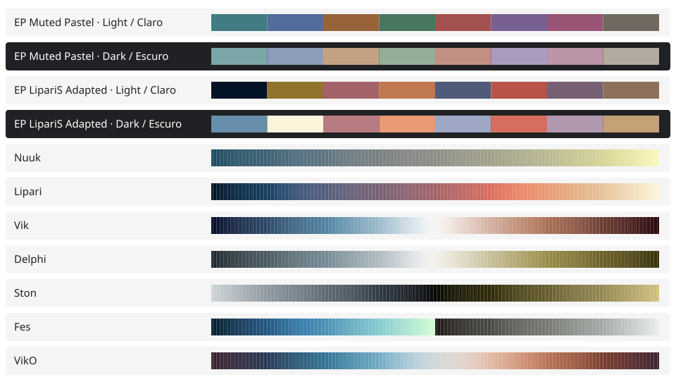

<a id="readme-top"></a>

<div align="center">

[🇺🇸 English](./README.md) &nbsp;|&nbsp; [🇧🇷 Português](./README.pt-BR.md)


# EP · Brand Assets

Identidade visual e infraestrutura compartilhada dos projetos profissionais de Eduardo Junior Pereira.

[GitHub](https://github.com/eduardojr-pereira) · [LinkedIn](https://www.linkedin.com/in/eduardo-jr-pereira/) · [Site do portfólio](https://eduardo-pereira.webflow.io/)

</div>

---

## Nesta Página

[Visão Geral](#ep-overview) · [Identidade Visual](#ep-visual-identity) · [Componentes Compartilhados](#ep-shared-components) · [Temas e Internacionalização](#ep-themes-and-internationalization) · [Sistema Cromático Analítico EP](#ep-ep-analytical-colour-system) · [Estrutura de Diretórios](#ep-directory-structure) · [Uso e Integração](#ep-usage-and-integration) · [Repositórios Relacionados](#ep-related-repositories) · [Licença](#ep-license) · [Contato](#ep-contact)

---

<a id="ep-overview"></a>

## Visão Geral

Este repositório é a fonte canônica da identidade EP e da infraestrutura compartilhada da vitrine, dos relatórios de projetos e dos READMEs profissionais. Centraliza tokens, tipografia, temas, mecanismos de interface bilíngue, ativos visuais, componentes e renderizadores. Os projetos mantêm seus próprios dados, análises e textos específicos.

---

<a id="ep-visual-identity"></a>

## Identidade Visual

A identidade utiliza o logotipo EP, a paleta institucional grafite e cobre, tipografia compartilhada, ícones sociais e animações Lottie. A paleta institucional é distinta do sistema cromático analítico.

| Recurso | Prévia | Arquivo |
|---|---|---|
| Logotipo EP |  | [`logo_initials.png`](./assets/logos/logo_initials.png) |
| GitHub |  | [`github_icon.svg`](./assets/icons/github_icon.svg) |
| LinkedIn |  | [`linkedin_icon.svg`](./assets/icons/linkedin_icon.svg) |
| E-mail |  | [`gmail_icon.svg`](./assets/icons/gmail_icon.svg) |
| Discord |  | [`discord_icon.svg`](./assets/icons/discord_icon.svg) |

Consulte as [animações](./assets/animations/) e os [tokens de tema](./styles/theme-tokens.css).

---

<a id="ep-shared-components"></a>

## Componentes Compartilhados

Os componentes são mantidos no EP Brand e reutilizados onde pertinente. O builder compõe a vitrine e os relatórios a partir das fontes canônicas, em vez de manter implementações separadas em cada projeto.

| Componente | Fonte |
|---|---|
| Configuração institucional | [`config/brand.json`](./config/brand.json) |
| Componentes web: Header, Footer, cards, botões, links, navegação e controles | [`components/web/`](./components/web/) |
| Rodapés Markdown bilíngues | [`components/markdown/`](./components/markdown/) |
| Scripts e interações compartilhados | [`scripts/`](./scripts/) |
| Composição, renderização e publicação | [`tools/`](./tools/) |
| Testes de regressão | [`tests/`](./tests/) |

---

<a id="ep-themes-and-internationalization"></a>

## Temas e Internacionalização

Os temas claro e escuro compartilham [tokens de tema](./styles/theme-tokens.css) e [tipografia](./styles/typography-v2.css). A [inicialização do tema](./scripts/theme-init.js), a [alternância de tema](./scripts/theme.js) e a [internacionalização da interface](./scripts/i18n.js) fornecem os mecanismos comuns. As traduções específicas permanecem em cada projeto. O [adaptador de tema Plotly](./scripts/plotly-theme.js) e o [adaptador de localização](./scripts/plotly-i18n.js) tratam a apresentação analítica, sem alterar os dados subjacentes.

---

<a id="ep-ep-analytical-colour-system"></a>

## Sistema Cromático Analítico EP

O Sistema Cromático Analítico EP separa a codificação visual dos dados da identidade institucional. Escolha a classe conforme a semântica dos dados e, depois, a representação adequada, o contraste e a codificação visual redundante.

| Classe | Principal | Secundária | Especializada |
|---|---|---|---|
| Categórica | EP Muted Pastel | EP LipariS Adapted | — |
| Sequencial | Nuuk | Lipari | — |
| Divergente | Vik | Delphi | Ston |
| Multissequencial | Fes | — | — |
| Cíclica | VikO | — | — |



Prévia gerada de [config/colormaps.json](./config/colormaps.json), a fonte canônica. As escalas contínuas utilizam Scientific Colour Maps 9.0.0 de Fabio Crameri; EP LipariS Adapted é uma adaptação, não uma escala oficial. Cores categóricas exigem sinais adicionais (marcadores, estilos de linha, padrões ou rótulos); o contraste isolado não garante acessibilidade. Consulte a [metodologia e atribuição](./docs/colormaps.md) e a [licença MIT](./docs/LICENSE-SCIENTIFIC-COLOUR-MAPS.txt). O [renderizador Plotly canônico](./tools/render_plotly.py) e o [CSS gerado](./styles/colormaps.css) utilizam a configuração cromática.

---

<a id="ep-directory-structure"></a>

## Estrutura de Diretórios

```text
ep-brand-assets/
├── assets/
│   ├── logos/
│   ├── icons/
│   └── animations/
├── components/
│   ├── markdown/
│   └── web/
├── config/
├── docs/
├── scripts/
├── styles/
├── tests/
├── tools/
├── README.md
└── README.pt-BR.md
```

---

<a id="ep-usage-and-integration"></a>

## Uso e Integração

Em outros repositórios, utilize os endereços públicos dos ativos.

```markdown

```

```html

```

Mantenha o checkout canônico do EP Brand ao lado do checkout do Portfolio. A partir do EP Brand, substitua o caminho de origem pelo caminho local do Portfolio; utilize um diretório de saída fora dos dois repositórios.

```bash
python3 tools/build_site.py --source /path/to/data-science-portfolio --output /tmp/ep-portfolio-preview
```

Visualize os rodapés Markdown sem alterar arquivos:

```bash
python3 tools/render_footer.py readme --kind portfolio --lang en
python3 tools/render_footer.py readme --kind knowledge-base --lang pt-BR
```

Com `--file`, o renderizador apresenta o diff proposto; somente `--apply` escreve alterações. Revise antes de aplicar. Renderize o Footer web com ativos embutidos utilizando `python3 tools/render_footer.py web --embed-assets`.

Testes de regressão a partir da raiz:

```bash
python3 -m unittest discover -s tests -v
```

Não renomeie ativos compartilhados sem verificar os consumidores. A geração local não publica alterações.

---

<a id="ep-related-repositories"></a>

## Repositórios Relacionados

| Repositório | Função |
|---|---|
| [Data Science Portfolio](https://github.com/eduardojr-pereira/data-science-portfolio) | Projetos aplicados, vitrine, Bike Sharing e Hangman. |
| [Data Science Knowledge Base](https://github.com/eduardojr-pereira/data-science-knowledge-base) | Conhecimento técnico e documentação profissional. |

---

<a id="ep-license"></a>

## Licença

Os ativos da identidade EP não implicam permissão de reutilização comercial ou redistribuição. Os termos podem ser definidos separadamente; ativos de terceiros mantêm seus direitos e licenças aplicáveis.

### Scientific Colour Maps — Licença MIT

| Item | Atribuição e condições |
|---|---|
| Obra original | Scientific Colour Maps 9.0.0 — Fabio Crameri |
| Copyright | Copyright (c) 2026, Fabio Crameri |
| Licença | [MIT — texto original integral da licença](./docs/LICENSE-SCIENTIFIC-COLOUR-MAPS.txt) |
| Referência | [DOI: 10.5281/zenodo.24343380](https://doi.org/10.5281/zenodo.24343380) |
| Escalas oficiais utilizadas | Nuuk, Lipari, Vik, Delphi, Ston, Fes e VikO |
| Paleta derivada | EP LipariS Adapted — adaptação EP, não uma paleta oficial de Scientific Colour Maps. |

A licença MIT permite uso, cópia, modificação e redistribuição, inclusive comercial, desde que os avisos originais de copyright e de permissão acompanhem todas as cópias ou partes substanciais. O texto integral da licença permanece preservado no repositório. Essa licença se aplica ao material original de Scientific Colour Maps, incluindo as partes utilizadas na adaptação EP e na prévia; não licencia automaticamente os demais ativos da identidade EP.

---

<a id="ep-contact"></a>

<!-- EP-FOOTER:START -->
## Contato

<div align="center">

<a href="https://eduardo-pereira.webflow.io/" title="Site pessoal — Eduardo Junior Pereira"></a>

**Eduardo Junior Pereira**

*Economics · Data Science · Analytics*

<a href="mailto:eduardojr.pereira@gmail.com"></a>&nbsp;&nbsp;
<a href="https://www.linkedin.com/in/eduardo-jr-pereira/"></a>&nbsp;&nbsp;
<a href="https://github.com/eduardojr-pereira"></a>

[Vamos nos conectar no LinkedIn para trocar ideias e oportunidades.](https://www.linkedin.com/in/eduardo-jr-pereira/)

[**Portfólio GitHub**](https://github.com/eduardojr-pereira/data-science-portfolio) &nbsp;•&nbsp; [**Base de Conhecimento**](https://github.com/eduardojr-pereira/data-science-knowledge-base)

</div>

<p align="right"><a href="#readme-top">↑ VOLTAR AO TOPO</a></p>

---
<!-- EP-FOOTER:END -->
