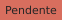

# EP Badge Library

**EP Badge Library — approved design; visual integration review pending.**

This library supports educational documentation, technology identification and noncommercial portfolio projects.

81 preserved SVGs: 57 active (48 technologies, 3 licenses, 6 localized statuses) and 24 compatibility-only assets (22 localized topics, 2 localized methods). Compatibility-only entries are not used in new report composition and are retained until all existing consumers have migrated and their references are verified. The 44 prepared PNG icons live in `assets/icons/technologies/`; original source files are preserved in its `originals/` subdirectory for provenance and future regeneration. They are not additional badge libraries.

## Visual specification

Flat-square SVG, height 20 px, icon box 14 × 14 px, 11 px Verdana/DejaVu Sans text, white icon tile, variable width. Original proportions and approved colors are preserved. Prepared PNGs are embedded in the SVGs; no external service is required to render them.

## Usage and maintenance

The generated SVGs and their prepared icons are preserved. `config/badges.json` is the source of metadata and provenance. `tools/badge_catalog.py` validates IDs/paths and owns technology ordering. `tools/render_badges.py` generates SVGs from the catalog and prepared PNGs; original sources, SHA-256 hashes, crop parameters and rights-review state remain recorded. Do not edit generated SVGs manually.

Markdown: `` (adjust relative path for the consumer). Cross-repository references must use the canonical published paths. HTML: ``; standalone builds may embed the canonical SVG as a data URI. Do not maintain independent copies as sources.

## Catalog, sources and rights review

A source link is provenance, not a redistribution license. Brand names and marks belong to their respective owners. No trademark permission is asserted. Experimental crops, ecosystem mappings, and third-party licenses must be checked before public use.

| Badge | Source | Selection / note | Rights review |
|---|---|---|---|
|  | Asset fornecido pelo autor | original; Símbolo CSS3 fornecido pelo autor; fundo quadriculado removido; proporção e cores preservadas. | pending |
|  | [Source](https://cdn.prod.website-files.com/65e8b43dbacbfb739916dc49/65eaa0b0d49c78b952e22d58_visual-studio-code-2019.svg) | original; Ícone fornecido pelo autor; cores e proporção preservadas. | pending |
|  | [Source](https://cdn.prod.website-files.com/65e8b43dbacbfb739916dc49/65eaa0b0d49c78b952e22d62_pytorch-logo.png) | image_direct; Imagem integral fornecida pelo autor; proporção e cores preservadas; fundo branco para contraste nos dois temas. | pending |
|  | [Source](https://cdn.prod.website-files.com/65e8b43dbacbfb739916dc49/65eaa0b0d49c78b952e22d64_beatifulsoup-logo.jpg) | image_direct; Imagem integral fornecida pelo autor; proporção e cores preservadas; fundo branco para contraste nos dois temas. | pending |
|  | [Source](https://cdn.prod.website-files.com/65e8b43dbacbfb739916dc49/65eaa0b0d49c78b952e22d57_anaconda-logo.svg) | original; Ícone fornecido pelo autor; cores e proporção preservadas. | pending |
|  | [Source](https://cdn.prod.website-files.com/65e8b43dbacbfb739916dc49/65eaa0b0d49c78b952e22d38_icon50-adobe-premiere-pro.png) | original; Ícone fornecido pelo autor; cores e proporção preservadas. | pending |
|  | [Source](https://cdn.prod.website-files.com/65e8b43dbacbfb739916dc49/65eaa0b0d49c78b952e22d3c_icon50-adobe-photoshop.png) | original; Ícone fornecido pelo autor; cores e proporção preservadas. | pending |
|  | [Source](https://cdn.prod.website-files.com/65e8b43dbacbfb739916dc49/65eaa0b0d49c78b952e22d45_icon50-adobe-after-effects.png) | original; Ícone fornecido pelo autor; cores e proporção preservadas. | pending |
|  | [Source](https://raw.githubusercontent.com/vega/altair/main/design/altair-logo-light.svg) | original; Original source colors preserved. | pending |
|  | [Source](https://s3.amazonaws.com/webflow-prod-assets/65e8b43dbacbfb739916dc49/65eabb02a15a8b694c889044_cassandra-logo.jpg) | original; Isolated eye symbol; horizontal SVG excluded. | pending |
|  | [Source](https://s3.amazonaws.com/webflow-prod-assets/65e8b43dbacbfb739916dc49/65eaa0b0d49c78b952e22d50_icon-hadoop.png) | cropped artwork; Elephant symbol extracted from the original artwork. | pending |
|  | [Source](https://github.com/devicons/devicon/blob/master/icons/apachespark/apachespark-original.svg) | compact; — | pending |
|  | [Source](https://bokeh.org/img/bokeh-icon.svg) | original; Symbol without text; brand size guidelines apply. | pending |
|  | [Source](https://github.com/simple-icons/simple-icons/blob/develop/icons/dlib.svg) | compact; — | pending |
|  | [Source](https://github.com/simple-icons/simple-icons/blob/develop/icons/docker.svg) | compact; Docker ecosystem symbol; colored monochrome variant. | pending |
|  | Asset fornecido pelo autor | original; Ícone genérico PyPI; não representa o logotipo oficial desta biblioteca. | pending |
|  | [Source](https://ipython.org/ipython-logo.png) | original; Original source colors preserved. | pending |
|  | Asset fornecido pelo autor | original; Ícone genérico PyPI; não representa o logotipo oficial desta biblioteca. | pending |
|  | [Source](https://github.com/devicons/devicon/blob/master/icons/java/java-original.svg) | compact; Subject to Oracle trademark terms. | pending |
|  | Asset fornecido pelo autor | cropped artwork; Large grey gear isolated; original retained. | pending |
|  | [Source](https://github.com/devicons/devicon/blob/master/icons/jupyter/jupyter-original.svg) | compact; Jupyter ecosystem symbol. | pending |
|  | [Source](https://s3.amazonaws.com/webflow-prod-assets/65e8b43dbacbfb739916dc49/65eaa0b0d49c78b952e22d5d_keras-logo.svg) | original; Original source colors preserved. | pending |
|  | [Source](https://raw.githubusercontent.com/dcurtis/markdown-mark/master/svg/markdown-mark.svg) | original; Original source colors preserved. | pending |
|  | [Source](https://github.com/matplotlib/matplotlib/blob/main/lib/matplotlib/mpl-data/images/matplotlib.svg) | compact; Artwork distributed with the Python package. | pending |
|  | [Source](https://s3.amazonaws.com/webflow-prod-assets/65e8b43dbacbfb739916dc49/65eaa0b0d49c78b952e22d3e_icon50-mongodb.png) | original; Original source colors preserved. | pending |
|  | Asset fornecido pelo autor | original; Ícone genérico PyPI; não representa o logotipo oficial desta biblioteca. | pending |
|  | Asset fornecido pelo autor | original; Ícone genérico PyPI compartilhado com nbformat; não é logotipo oficial do NLTK. | pending |
|  | [Source](https://s3.amazonaws.com/webflow-prod-assets/65e8b43dbacbfb739916dc49/65eaa0b0d49c78b952e22d5f_numpy-logo.png) | original; Original source colors preserved. | pending |
|  | [Source](https://onnxruntime.ai/images/logos/onnxruntime/ORT_icon_for_light_bg.svg) | original; Original source colors preserved. | pending |
|  | [Source](https://s3.amazonaws.com/webflow-prod-assets/65e8b43dbacbfb739916dc49/65eaa0b0d49c78b952e22d69_openCV-logo.png) | cropped artwork; Cropped artwork; original proportions preserved. | pending |
|  | Asset fornecido pelo autor | image_direct; Imagem integral fornecida pelo autor; proporção e cores preservadas; fundo branco para contraste nos dois temas. | pending |
|  | [Source](https://github.com/devicons/devicon/blob/master/icons/pandas/pandas-original.svg) | compact; — | pending |
|  | [Source](https://s3.amazonaws.com/webflow-prod-assets/65e8b43dbacbfb739916dc49/65eaa0b0d49c78b952e22d7a_Plotly-logo.png) | cropped artwork; Cropped artwork; original proportions preserved. | pending |
|  | [Source](https://raw.githubusercontent.com/pola-rs/polars-static/master/logos/polars_logo_blue.svg) | original; Original source colors preserved. | pending |
|  | [Source](https://www.postgresql.org/media/img/about/press/elephant.png) | original; Original source colors preserved. | pending |
|  | [Source](https://github.com/devicons/devicon/blob/master/icons/apachespark/apachespark-original.svg) | compact; Shared Apache Spark symbol, not a dedicated PySpark mark. | pending |
|  | [Source](https://s3.amazonaws.com/webflow-prod-assets/65e8b43dbacbfb739916dc49/65eaa0b0d49c78b952e22d6c_python-logo.png) | original; Original source colors preserved. | pending |
|  | [Source](https://scikit-image.org/docs/stable/api/skimage.data.html#skimage.data.logo) | compact; Artwork distributed with the Python package. | pending |
|  | [Source](https://cdn.prod.website-files.com/65e8b43dbacbfb739916dc49/65eaa0b0d49c78b952e22d6f_scikit-learn-logo.png) | image_direct; Imagem integral fornecida pelo autor; proporção e cores preservadas; fundo branco para contraste nos dois temas. | pending |
|  | [Source](https://scipy.org/images/logo.svg) | original; Original source colors preserved. | pending |
|  | [Source](https://s3.amazonaws.com/webflow-prod-assets/65e8b43dbacbfb739916dc49/65eaa0b0d49c78b952e22d6e_seaborn-logo.svg) | cropped artwork; Cropped artwork; original proportions preserved. | pending |
|  | [Source](https://cdn.prod.website-files.com/65e8b43dbacbfb739916dc49/65eaa0b0d49c78b952e22d71_SpaCy-logo.png) | image_direct; Imagem integral fornecida pelo autor; proporção e cores preservadas; fundo branco para contraste nos dois temas. | pending |
|  | [Source](https://github.com/devicons/devicon/blob/master/icons/sqlite/sqlite-original.svg) | compact; — | pending |
|  | [Source](https://www.statsmodels.org/devel/_static/statsmodels-logo-v2-no-text.svg) | original; Original source colors preserved. | pending |
|  | — | text; Badge tipográfica: cobre EP, texto branco, sem logotipo. | not_applicable |
|  | [Source](https://s3.amazonaws.com/webflow-prod-assets/65e8b43dbacbfb739916dc49/65eaa0b0d49c78b952e22d76_tensorflow-logo.png) | original; Original source colors preserved. | pending |
|  | [Source](https://www.w3.org/html/logo/downloads/HTML5_Badge.svg) | original; Original source colors preserved. | pending |
|  | [Source](https://raw.githubusercontent.com/voodootikigod/logo.js/master/js.svg) | original; Original source colors preserved. | pending |
|  | — | license_split; Mineral blue identifier and theme-adaptive monochrome prefix. | not_applicable |
|  | — | license_split; Mineral blue identifier and theme-adaptive monochrome prefix. | not_applicable |
|  | — | license_split; dataset attribution license, same approved theme palette. | not_applicable |
|  | — | text; Localized path preserved for README compatibility. | not_applicable |
|  | — | text; Localized path preserved for README compatibility. | not_applicable |
|  | — | text; Localized path preserved for README compatibility. | not_applicable |
|  | — | text; Localized path preserved for README compatibility. | not_applicable |
|  | — | text; Localized path preserved for README compatibility. | not_applicable |
|  | — | text; Localized path preserved for README compatibility. | not_applicable |


## Licensing and third-party attribution

Third-party logos and trademarks belong to their respective owners.
Their use is solely for technology identification and does not imply
endorsement, sponsorship or affiliation.

Source libraries and license references:

- [Devicon](https://github.com/devicons/devicon/blob/master/LICENSE)
  — MIT.
- [Simple Icons](https://github.com/simple-icons/simple-icons/blob/develop/LICENSE.md)
  — CC0 1.0, subject to individual brand restrictions.
- [Markdown Mark](https://github.com/dcurtis/markdown-mark)
  — CC0 1.0.
- [HTML5 Logo](https://www.w3.org/html/logo/)
  — CC BY 3.0, attributed to W3C.
- Other technology marks retain their respective rights and terms.

EP repository licenses:

- [Code — MIT](../LICENSE-CODE.txt)
- [Original documentation — CC BY-NC 4.0](../LICENSE-CONTENT.md)
- [EP visual identity](../LICENSE-BRAND.md)

Third-party artwork is not relicensed under the EP licenses.
Source attribution does not constitute a grant of additional rights.


## Website integration

The current library preserves 81 SVGs (57 active and 24 compatibility-only). The following inventory records the preserved paths, not a requirement to render every category.

| Category | Badge | Path |
|---|---|---|
| methods | Time-series CV | `assets/badges/methods/time_series_cv_en.svg` |
| methods | Validação cruzada temporal | `assets/badges/methods/time_series_cv_pt_br.svg` |
| topics | Supplementary Resources | `assets/badges/topics/supplementary_resources_en.svg` |
| topics | Recursos Complementares | `assets/badges/topics/supplementary_resources_pt_br.svg` |
| topics | Python Programming | `assets/badges/topics/python_programming_en.svg` |
| topics | Programação em Python | `assets/badges/topics/python_programming_pt_br.svg` |
| topics | Data Analysis & Visualization | `assets/badges/topics/data_analytics_en.svg` |
| topics | Análise e Visualização de Dados | `assets/badges/topics/data_analytics_pt_br.svg` |
| topics | Statistics | `assets/badges/topics/statistics_en.svg` |
| topics | Estatística | `assets/badges/topics/statistics_pt_br.svg` |
| topics | Relational & NoSQL Databases | `assets/badges/topics/relational_nosql_databases_en.svg` |
| topics | Bancos de Dados Relacionais e NoSQL | `assets/badges/topics/relational_nosql_databases_pt_br.svg` |
| topics | Machine Learning | `assets/badges/topics/machine_learning_en.svg` |
| topics | Aprendizado de Máquina | `assets/badges/topics/machine_learning_pt_br.svg` |
| topics | Natural Language Processing | `assets/badges/topics/natural_language_processing_en.svg` |
| topics | Processamento de Linguagem Natural | `assets/badges/topics/natural_language_processing_pt_br.svg` |
| topics | Deep Learning | `assets/badges/topics/deep_learning_en.svg` |
| topics | Aprendizado Profundo | `assets/badges/topics/deep_learning_pt_br.svg` |
| topics | Image Analysis & Classification | `assets/badges/topics/image_analysis_classification_en.svg` |
| topics | Análise e Classificação de Imagens | `assets/badges/topics/image_analysis_classification_pt_br.svg` |
| topics | Recommender Systems | `assets/badges/topics/recommender_systems_en.svg` |
| topics | Sistemas de Recomendação | `assets/badges/topics/recommender_systems_pt_br.svg` |
| topics | Big Data & Distributed Processing | `assets/badges/topics/big_data_distributed_processing_en.svg` |
| topics | Big Data e Processamento Distribuído | `assets/badges/topics/big_data_distributed_processing_pt_br.svg` |

The shared `badges(items)` and `method_badges(items)` macros in `components/web/badges.html` consume canonical paths and localized labels. The shared asset service applies explicit image variants. The future builder resolves catalog paths and standalone embedding where required.

Generated HTML is a consumer of the canonical library,
not an independent source of badge artwork.

<!-- EP-BADGES-LOTE-20261124 -->
Revisão visual local: imagens diretas (incluindo PyTorch), ícones PyPI genéricos e cinco ícones de ferramentas; Surprise tipográfico. Direitos de uso das marcas pendentes.

## Current category rules (7C)

| Category | READMEs | New report/showcase composition | Preserved SVGs |
|---|---|---|---:|
| Technologies | Yes | Graphical badges; report Hero | 48 |
| Licenses | Yes | Graphical links; code/content in Hero, data in Data Source | 3 |
| Status | Yes | Graphical badges only for evidenced status | 6 |
| Topics | No | Text links to Knowledge Base, without arrows | 22 compatibility-only |
| Methods | No | Informational text tags via canonical HTML/CSS | 2 compatibility-only |
| Total | | 57 active | 81 |

The retained Topics/Methods SVGs and catalog metadata are marked `legacy_only`; `active_entry()` refuses them for new graphical badge selection. They are not candidates for new generation. Retain the existing assets until consumer migration and reference validation permit removal. No SVG is deleted or rewritten by 7C. The eleven KB areas (00–10) remain the source of Topic links; the stable `data_analytics` ID/path remains intact in the compatibility inventory. Old embedded graphics and historical releases cannot be proven absent using textual reference searches alone. Review actual published consumers in the migration/publication phase before authorizing removal.

### Approved graphical style

- Flat-square SVG, height 20 px, text 11 px Verdana/DejaVu Sans, variable width recorded per entry. Verify text fit before adding/changing widths.
- Icon + name: 24 px white tile, 14 × 14 px icon box, existing original/prepared artwork and approved per-entry colors. Direct image: 18 px high area with 2 px side padding, white background, no repeated text; preserve artwork proportions. The five approved direct artwork entries remain unchanged. Surprise is the approved text-only technology (copper `#9D603B`, white text). Other text-only choices require explicit approval.
- The generic PyPI artwork is explicitly approved for ipykernel, ipywidgets, nbformat and NLTK; it is not their official logo. Other ecosystem substitutions require approval and provenance. Preserve distinct Apache Spark and PySpark IDs even when their artwork is identical.
- Licenses use the approved mineral blue pair (`#505B7A` / `#FFFFFF` light; `#9EA7C4` / `#242424` dark) and inverse monochrome prefix. Status colors are unchanged in the manifest. Data license never implies a license for authored code or content.
- Contrast at least 4.5:1 for rendered text, including both adaptive variants and license prefixes. Direct artwork is not a text badge. Rights-review entries remain unchanged and unresolved rights require review before public use.

### Consumption and ordering

Resolve `technology_ids(ids)` to deduplicate by canonical ID and stably partition artwork first, text-only last, preserving relative order. This applies to both HTML and Markdown. `active_entry(id)` resolves active metadata without introducing a builder. The HTML renderer receives resolved ordered `{src,label}` items, with optional `href`, `en_src`/`pt_br_src` or `light`/`dark` image pairs. Use `message(key)` for translated references; no additional preference handler. `method_badges(items)` receives a list of localized message references, renders neutral informational text, and uses theme tokens rather than per-method SVGs. Methods do not receive links. Topic links use the existing text-link primitive, and are composed in References (7E). Standalone SVGs retain `prefers-color-scheme`; explicit theme and language switching follows [presentation](presentation.md). No theme or language preference is owned by badges.

### Maintenance commands

```sh
python tools/render_badges.py --check
python tools/render_badges.py --check --id python
python tools/render_badges.py --write --id python
python tools/render_badges.py --write --all
python tests/test_badges.py
```

The default and `--check` are read-only. Without IDs, checks cover every preserved SVG including compatibility assets. `--write` requires `--id` or `--all`, prevalidates the selected active entries, then writes only those generated SVG paths. It never writes original/prepared artwork or changes the manifest; it does not generate legacy-only categories. `--all` explicitly selects the active catalog. No automatic regeneration during a website build. Rendering uses prepared PNG bytes and preserves the approved SVG structure; a mismatch is reported instead of silently overwriting existing artwork. Verification checks metadata, source hashes, embedded PNGs, geometry, contrast, locale pairs and catalog/path parity; visual fit, trademark rights and publication are separate checks. Use the exact generated path, do not maintain copied source assets in consumers.

### Adding or changing an active badge

1. Reuse existing canonical ID if possible. For a new technology, obtain suitable traceable artwork and confirm rights; store original under `assets/icons/technologies/originals/` and prepared PNG under `assets/icons/technologies/`. Record original hash, crop, provenance, approval and rights state using the manifest schema.
2. Enter the approved format, dimensions and colors in `config/badges.json` (same schema as comparable active entry). For text-only technology, explicit approval, `mode: text`, `icon: null`, `approved_text_only: true`; for direct image, `mode: image_direct`. Preserve source files and stable IDs. Do not invent aliases or change an existing ID. Verify font fit and image geometry.
3. Generate that ID with `--write --id`, verify the catalog with `--check` and run `tests/test_badges.py`; review the diff, theme and locale behavior and affected consumer paths. Update provenance/rights documentation when adding or changing artwork. Only regenerate all by deliberate choice. Publish only authorized changes and verify public asset references. No new Topic/Method SVG is needed.

Report usage: the Hero presents linked original code/content licenses and Technologies. Data Source presents the actual linked dataset license when known. Technical References presents text Topic links and Methods tags (no tabs, automatic rotation, technology duplication or repeated Reproducibility section); implementation is 7E. Full reproducibility instructions remain in the linked project documentation. Historical SVGs remain intact until migration and removal are separately validated.
