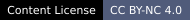
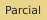

# EP Badge Library

**EP Badge Library — approved design; visual integration review pending.**

This library supports educational documentation, technology identification and noncommercial portfolio projects.

80 SVG badges: 48 technologies, 2 licenses, 6 localized statuses, 22 localized topics and 2 localized methods. The 44 prepared PNG icons live in `assets/icons/technologies/`; original source files are preserved in its `originals/` subdirectory for provenance and future regeneration. They are not additional badge libraries.

## Visual specification

Flat-square SVG, height 20 px, icon box 14 × 14 px, 11 px Verdana/DejaVu Sans text, white icon tile, variable width. Original proportions and approved colors are preserved. Prepared PNGs are embedded in the SVGs; no external service is required to render them.

## Usage and maintenance

Run `python3 tools/render_badges.py` from the repository root to regenerate the SVGs offline from `config/badges.json` and prepared icons. Original sources, SHA-256 hashes, crop parameters and rights-review state are recorded in that manifest. Do not edit generated SVGs manually.

Markdown: `` (adjust relative path for the consumer). Cross-repository references must use the canonical published paths. HTML: ``; standalone builds may embed the canonical SVG as a data URI. Do not maintain independent copies as sources.

## Catalog, sources and rights review

A source link is provenance, not a redistribution license. Brand names and marks belong to their respective owners. No trademark permission is asserted. Experimental crops, ecosystem mappings, and third-party licenses must be checked before public use.

| Badge | Source | Selection / note | Rights review |
|---|---|---|---|
|  | Asset fornecido pelo autor | original; Símbolo CSS3 fornecido pelo autor; fundo quadriculado removido; proporção e cores preservadas. | pending |
|  | [Source](https://cdn.prod.website-files.com/65e8b43dbacbfb739916dc49/65eaa0b0d49c78b952e22d58_visual-studio-code-2019.svg) | original; Ícone fornecido pelo autor; cores e proporção preservadas. | pending |
|  | [Source](https://cdn.prod.website-files.com/65e8b43dbacbfb739916dc49/65eaa0b0d49c78b952e22d62_pytorch-logo.png) | image_direct; Imagem integral fornecida pelo autor; proporção e cores preservadas; fundo branco para contraste nos dois temas. | pending |
|  | [Source](https://cdn.prod.website-files.com/65e8b43dbacbfb739916dc49/65eaa0b0d49c78b952e22d64_beatifulsoup-logo.jpg) | image_direct; Imagem integral fornecida pelo autor; proporção e cores preservadas; fundo branco para contraste nos dois temas. | pending |
|  | [Source](https://cdn.prod.website-files.com/65e8b43dbacbfb739916dc49/65eaa0b0d49c78b952e22d57_anaconda-logo.svg) | original; Ícone fornecido pelo autor; cores e proporção preservadas. | pending |
|  | [Source](https://cdn.prod.website-files.com/65e8b43dbacbfb739916dc49/65eaa0b0d49c78b952e22d38_icon50-adobe-premiere-pro.png) | original; Ícone fornecido pelo autor; cores e proporção preservadas. | pending |
|  | [Source](https://cdn.prod.website-files.com/65e8b43dbacbfb739916dc49/65eaa0b0d49c78b952e22d3c_icon50-adobe-photoshop.png) | original; Ícone fornecido pelo autor; cores e proporção preservadas. | pending |
|  | [Source](https://cdn.prod.website-files.com/65e8b43dbacbfb739916dc49/65eaa0b0d49c78b952e22d45_icon50-adobe-after-effects.png) | original; Ícone fornecido pelo autor; cores e proporção preservadas. | pending |
|  | [Source](https://raw.githubusercontent.com/vega/altair/main/design/altair-logo-light.svg) | original; Original source colors preserved. | pending |
|  | [Source](https://s3.amazonaws.com/webflow-prod-assets/65e8b43dbacbfb739916dc49/65eabb02a15a8b694c889044_cassandra-logo.jpg) | original; Isolated eye symbol; horizontal SVG excluded. | pending |
|  | [Source](https://s3.amazonaws.com/webflow-prod-assets/65e8b43dbacbfb739916dc49/65eaa0b0d49c78b952e22d50_icon-hadoop.png) | cropped artwork; Elephant symbol extracted from the original artwork. | pending |
|  | [Source](https://github.com/devicons/devicon/blob/master/icons/apachespark/apachespark-original.svg) | compact; — | pending |
|  | [Source](https://bokeh.org/img/bokeh-icon.svg) | original; Symbol without text; brand size guidelines apply. | pending |
|  | [Source](https://github.com/simple-icons/simple-icons/blob/develop/icons/dlib.svg) | compact; — | pending |
|  | [Source](https://github.com/simple-icons/simple-icons/blob/develop/icons/docker.svg) | compact; Docker ecosystem symbol; colored monochrome variant. | pending |
|  | Asset fornecido pelo autor | original; Ícone genérico PyPI; não representa o logotipo oficial desta biblioteca. | pending |
|  | [Source](https://ipython.org/ipython-logo.png) | original; Original source colors preserved. | pending |
|  | Asset fornecido pelo autor | original; Ícone genérico PyPI; não representa o logotipo oficial desta biblioteca. | pending |
|  | [Source](https://github.com/devicons/devicon/blob/master/icons/java/java-original.svg) | compact; Subject to Oracle trademark terms. | pending |
|  | Asset fornecido pelo autor | cropped artwork; Large grey gear isolated; original retained. | pending |
|  | [Source](https://github.com/devicons/devicon/blob/master/icons/jupyter/jupyter-original.svg) | compact; Jupyter ecosystem symbol. | pending |
|  | [Source](https://s3.amazonaws.com/webflow-prod-assets/65e8b43dbacbfb739916dc49/65eaa0b0d49c78b952e22d5d_keras-logo.svg) | original; Original source colors preserved. | pending |
|  | [Source](https://raw.githubusercontent.com/dcurtis/markdown-mark/master/svg/markdown-mark.svg) | original; Original source colors preserved. | pending |
|  | [Source](https://github.com/matplotlib/matplotlib/blob/main/lib/matplotlib/mpl-data/images/matplotlib.svg) | compact; Artwork distributed with the Python package. | pending |
|  | [Source](https://s3.amazonaws.com/webflow-prod-assets/65e8b43dbacbfb739916dc49/65eaa0b0d49c78b952e22d3e_icon50-mongodb.png) | original; Original source colors preserved. | pending |
|  | Asset fornecido pelo autor | original; Ícone genérico PyPI; não representa o logotipo oficial desta biblioteca. | pending |
|  | Asset fornecido pelo autor | original; Ícone genérico PyPI compartilhado com nbformat; não é logotipo oficial do NLTK. | pending |
|  | [Source](https://s3.amazonaws.com/webflow-prod-assets/65e8b43dbacbfb739916dc49/65eaa0b0d49c78b952e22d5f_numpy-logo.png) | original; Original source colors preserved. | pending |
|  | [Source](https://onnxruntime.ai/images/logos/onnxruntime/ORT_icon_for_light_bg.svg) | original; Original source colors preserved. | pending |
|  | [Source](https://s3.amazonaws.com/webflow-prod-assets/65e8b43dbacbfb739916dc49/65eaa0b0d49c78b952e22d69_openCV-logo.png) | cropped artwork; Cropped artwork; original proportions preserved. | pending |
|  | Asset fornecido pelo autor | image_direct; Imagem integral fornecida pelo autor; proporção e cores preservadas; fundo branco para contraste nos dois temas. | pending |
|  | [Source](https://github.com/devicons/devicon/blob/master/icons/pandas/pandas-original.svg) | compact; — | pending |
|  | [Source](https://s3.amazonaws.com/webflow-prod-assets/65e8b43dbacbfb739916dc49/65eaa0b0d49c78b952e22d7a_Plotly-logo.png) | cropped artwork; Cropped artwork; original proportions preserved. | pending |
|  | [Source](https://raw.githubusercontent.com/pola-rs/polars-static/master/logos/polars_logo_blue.svg) | original; Original source colors preserved. | pending |
|  | [Source](https://www.postgresql.org/media/img/about/press/elephant.png) | original; Original source colors preserved. | pending |
|  | [Source](https://github.com/devicons/devicon/blob/master/icons/apachespark/apachespark-original.svg) | compact; Shared Apache Spark symbol, not a dedicated PySpark mark. | pending |
|  | [Source](https://s3.amazonaws.com/webflow-prod-assets/65e8b43dbacbfb739916dc49/65eaa0b0d49c78b952e22d6c_python-logo.png) | original; Original source colors preserved. | pending |
|  | [Source](https://scikit-image.org/docs/stable/api/skimage.data.html#skimage.data.logo) | compact; Artwork distributed with the Python package. | pending |
|  | [Source](https://cdn.prod.website-files.com/65e8b43dbacbfb739916dc49/65eaa0b0d49c78b952e22d6f_scikit-learn-logo.png) | image_direct; Imagem integral fornecida pelo autor; proporção e cores preservadas; fundo branco para contraste nos dois temas. | pending |
|  | [Source](https://scipy.org/images/logo.svg) | original; Original source colors preserved. | pending |
|  | [Source](https://s3.amazonaws.com/webflow-prod-assets/65e8b43dbacbfb739916dc49/65eaa0b0d49c78b952e22d6e_seaborn-logo.svg) | cropped artwork; Cropped artwork; original proportions preserved. | pending |
|  | [Source](https://cdn.prod.website-files.com/65e8b43dbacbfb739916dc49/65eaa0b0d49c78b952e22d71_SpaCy-logo.png) | image_direct; Imagem integral fornecida pelo autor; proporção e cores preservadas; fundo branco para contraste nos dois temas. | pending |
|  | [Source](https://github.com/devicons/devicon/blob/master/icons/sqlite/sqlite-original.svg) | compact; — | pending |
|  | [Source](https://www.statsmodels.org/devel/_static/statsmodels-logo-v2-no-text.svg) | original; Original source colors preserved. | pending |
|  | — | text; Badge tipográfica: cobre EP, texto branco, sem logotipo. | not_applicable |
|  | [Source](https://s3.amazonaws.com/webflow-prod-assets/65e8b43dbacbfb739916dc49/65eaa0b0d49c78b952e22d76_tensorflow-logo.png) | original; Original source colors preserved. | pending |
|  | [Source](https://www.w3.org/html/logo/downloads/HTML5_Badge.svg) | original; Original source colors preserved. | pending |
|  | [Source](https://raw.githubusercontent.com/voodootikigod/logo.js/master/js.svg) | original; Original source colors preserved. | pending |
|  | — | license_split; Mineral blue identifier and theme-adaptive monochrome prefix. | not_applicable |
|  | — | license_split; Mineral blue identifier and theme-adaptive monochrome prefix. | not_applicable |
|  | — | text; Localized path preserved for README compatibility. | not_applicable |
|  | — | text; Localized path preserved for README compatibility. | not_applicable |
|  | — | text; Localized path preserved for README compatibility. | not_applicable |
|  | — | text; Localized path preserved for README compatibility. | not_applicable |
|  | — | text; Localized path preserved for README compatibility. | not_applicable |
|  | — | text; Localized path preserved for README compatibility. | not_applicable |

## Licensing and third-party attribution

Third-party logos and trademarks belong to their respective owners.
Their use is solely for technology identification and does not imply
endorsement, sponsorship or affiliation.

Source libraries and license references:

- [Devicon](https://github.com/devicons/devicon/blob/master/LICENSE)
  — MIT.
- [Simple Icons](https://github.com/simple-icons/simple-icons/blob/develop/LICENSE.md)
  — CC0 1.0, subject to individual brand restrictions.
- [Markdown Mark](https://github.com/dcurtis/markdown-mark)
  — CC0 1.0.
- [HTML5 Logo](https://www.w3.org/html/logo/)
  — CC BY 3.0, attributed to W3C.
- Other technology marks retain their respective rights and terms.

EP repository licenses:

- [Code — MIT](../LICENSE-CODE.txt)
- [Original documentation — CC BY-NC 4.0](../LICENSE-CONTENT.md)
- [EP visual identity](../LICENSE-BRAND.md)

Third-party artwork is not relicensed under the EP licenses.
Source attribution does not constitute a grant of additional rights.

## Website integration

The original 48-badge library is extended with nine text-only
badges for existing website technologies, categories and methods.

The current library contains 80 SVG badges.

| Category | Badge | Path |
|---|---|---|
| methods | Time-series CV | `assets/badges/methods/time_series_cv_en.svg` |
| methods | Validação cruzada temporal | `assets/badges/methods/time_series_cv_pt_br.svg` |
| topics | Supplementary Resources | `assets/badges/topics/supplementary_resources_en.svg` |
| topics | Recursos Complementares | `assets/badges/topics/supplementary_resources_pt_br.svg` |
| topics | Python Programming | `assets/badges/topics/python_programming_en.svg` |
| topics | Programação em Python | `assets/badges/topics/python_programming_pt_br.svg` |
| topics | Data Analysis & Visualization | `assets/badges/topics/data_analytics_en.svg` |
| topics | Análise e Visualização de Dados | `assets/badges/topics/data_analytics_pt_br.svg` |
| topics | Statistics | `assets/badges/topics/statistics_en.svg` |
| topics | Estatística | `assets/badges/topics/statistics_pt_br.svg` |
| topics | Relational & NoSQL Databases | `assets/badges/topics/relational_nosql_databases_en.svg` |
| topics | Bancos de Dados Relacionais e NoSQL | `assets/badges/topics/relational_nosql_databases_pt_br.svg` |
| topics | Machine Learning | `assets/badges/topics/machine_learning_en.svg` |
| topics | Aprendizado de Máquina | `assets/badges/topics/machine_learning_pt_br.svg` |
| topics | Natural Language Processing | `assets/badges/topics/natural_language_processing_en.svg` |
| topics | Processamento de Linguagem Natural | `assets/badges/topics/natural_language_processing_pt_br.svg` |
| topics | Deep Learning | `assets/badges/topics/deep_learning_en.svg` |
| topics | Aprendizado Profundo | `assets/badges/topics/deep_learning_pt_br.svg` |
| topics | Image Analysis & Classification | `assets/badges/topics/image_analysis_classification_en.svg` |
| topics | Análise e Classificação de Imagens | `assets/badges/topics/image_analysis_classification_pt_br.svg` |
| topics | Recommender Systems | `assets/badges/topics/recommender_systems_en.svg` |
| topics | Sistemas de Recomendação | `assets/badges/topics/recommender_systems_pt_br.svg` |
| topics | Big Data & Distributed Processing | `assets/badges/topics/big_data_distributed_processing_en.svg` |
| topics | Big Data e Processamento Distribuído | `assets/badges/topics/big_data_distributed_processing_pt_br.svg` |

The shared `tools/badge_html.py` renderer embeds canonical SVG
artwork in standalone HTML documents. Localized badges follow
the document language through the shared stylesheet.

Generated HTML is a consumer of the canonical library,
not an independent source of badge artwork.

<!-- EP-BADGES-LOTE-20261124 -->
Revisão visual local: imagens diretas (incluindo PyTorch), ícones PyPI genéricos e cinco ícones de ferramentas; Surprise tipográfico. Direitos de uso das marcas pendentes.

## Approved category rules

Topics: 11 Knowledge Base areas, EN/PT-BR; existing `data_analytics` path is retained for area 02. Topics use EP LipariS Adapted index 4, Methods use EP Muted Pastel index 0. Methods and Technologies expand through the manifest only, with no predetermined cap. Technology lists are stably partitioned (icons first, text-only last). License prefixes switch white/black with theme; both identifiers use EP LipariS Adapted index 4 (mineral blue). Partial uses approved soft yellow #E8D58A with graphite text, an explicit exception to analytical colormaps. Pending uses EP LipariS Adapted dark index 5. Standalone SVG uses `prefers-color-scheme`; HTML uses the explicit EP theme. GitHub's selected theme may not match the browser color scheme; verify in GitHub after publishing. No README paths are removed.
